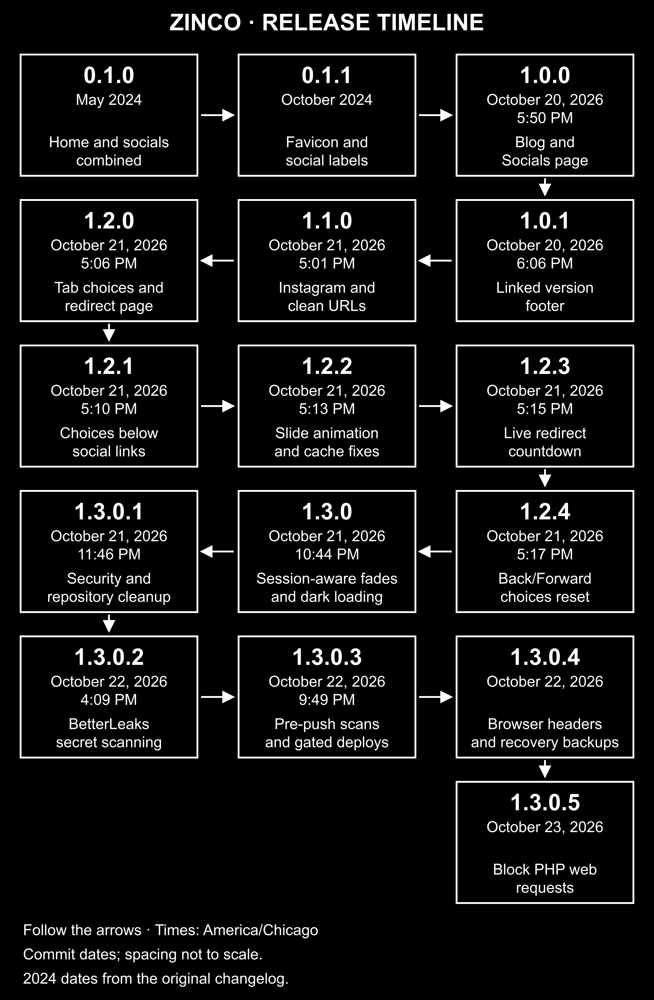

This is my first attempt to create my own website. Let's see how this goes.

# To-Do List

**Legend:** ✅ Completed · 🟨 Planned · \[❓\] Undecided

- ✅ **Blog** — For thought pieces, introspection, and other things that are best written out.
- ✅ **Biography** — Telling new visitors to my website who I am, what I do, and how to contact me.

- \[❓\] **Cool looking layout** — Layout is unlikely to be in any way cool looking as this started as a website to replace my Linktree. I need inspiration anyway to design something cool looking.

- \[❓\] Activity Log — Place to log activities in my daily life, what I've been up to, and maybe linking to my blog (who knows?).

# Deployment

Pushes to `main` first run BetterLeaks, then update and deploy the website through the cPanel API only if the scan succeeds. Manually requested deployments use the same prerequisite. A failed, cancelled, or unavailable scan prevents deployment. Connection details are stored in GitHub Actions secrets (`CPANEL_HOST`, `CPANEL_USERNAME`, `CPANEL_REPOSITORY_ROOT`, and `CPANEL_API_TOKEN`), not in source files, and are provided only to the deployment job. The workflow waits for cPanel to confirm the deployed commit and checks the live homepage version. View [deployment runs](https://github.com/zincodrone/zinco.gay-website/actions/workflows/deploy-cpanel.yml).

## Repository security

GitHub Actions scans the full fetched Git history on pushes, pull requests, and manual runs using [BetterLeaks v1.9.0](https://github.com/betterleaks/betterleaks/releases/tag/v1.9.0). The release archive is pinned and verified against its SHA-256 checksum before execution. Secret values are fully redacted, and live credential validation is explicitly disabled. The scan uses read-only repository permissions and does not retain checkout credentials. Local environment files and private-key files are excluded from Git by `.gitignore`; real credentials belong in GitHub Actions secrets. These checks reduce accidental exposure but do not guarantee that every security issue will be detected.

GitHub's server-side secret scanning and push protection were confirmed enabled for this repository on October 22, 2026. They block supported secret types before upload, including pushes from other machines and GitHub-based edits. Coverage depends on GitHub's supported patterns and permitted bypasses.

### Browser and hosting protections

The deployed `.htaccess` disables directory listings and sets a Content Security Policy that permits local assets and only the exact inline scripts and styles used by the site. It also blocks framing, disables MIME sniffing, limits referrer information, disables unused device permissions, and enables HTTPS-only browsing for one week after a secure visit. The HTTPS policy applies to this hostname only; it does not include subdomains or preload registration.

PHP-family requests are denied in the public website directory, including mixed-case names, double extensions, and extra path segments. This static site does not need PHP. This is an HTTP access restriction, not removal or account-wide disabling of PHP. Hosting-managed cPanel and Webmail routes can bypass the website directory rules and remain separate.

When changing inline HTML scripts or styles, run `python .github/scripts/check_site_security.py --update`, review the generated policy, and test the site. The security workflow checks those hashes before allowing deployment. Existing fades, the GIF background, social choices, and redirects must continue working under the policy.

### Maintenance

Dependabot vulnerability alerts and security-update proposals are enabled for dependencies GitHub can identify. The version-update configuration checks GitHub Actions monthly and opens grouped proposals, with at most three open update pull requests. It does not automatically merge or publish them. SHA-pinned Actions and separately downloaded tools still need version maintenance; enabling alerts is not a guarantee of complete coverage. Review proposals and keep the version, README, and timeline aligned before release. BetterLeaks is a separately pinned binary: review its [stable releases](https://github.com/betterleaks/betterleaks/releases/latest) during monthly maintenance and update the workflow, installer checksums, and documentation together when upgrading.

### Recovery backups

Before substantial changes, run:

```sh
python .github/scripts/create_recovery_backup.py
```

The default destination is a `website-recovery-backups` folder beside this checkout, outside the repository and `public_html`. Each dated backup contains a verified Git bundle of committed reachable history, ZIPs of the current public website and deployment configuration, observed root/`www` DNS records, SHA-256 checksums, and restoration notes. The manifest identifies the committed revision and whether working files include uncommitted changes. The script refuses destinations inside the repository or `public_html`.

The DNS snapshot is not a complete PremiumDNS zone export. Save a complete export from Namecheap separately, along with a full private hosting-account backup. After publishing the workflow, **Actions → Create private hosting backup → Run workflow** requests a full cPanel backup to the account's private home directory and waits for cPanel to report completion. It runs only on demand and never uploads the account backup as a GitHub artifact. This account-wide backup can include mail, databases, and other hosted files. Download it through cPanel to a private encrypted backup location; full account restoration can require the hosting provider. The status check uses cPanel's older read-only API 2 endpoint because the UAPI backup list does not distinguish pending and completed manual backups; if unavailable, use cPanel's Backup Wizard.

Local recovery archives are not encrypted by this script and do not export credentials or full account settings. Keep copies on a private encrypted drive, never under `public_html` or in Git. Restore the repository into a new folder with `git clone repository.bundle restored-website`, verify archive hashes against `manifest.json`, reinstall the local hook, and recreate deployment secrets from your password manager before publishing. Test recovery into a separate folder before using a backup to replace the live site.

### Before pushing from a local checkout

With Python 3 installed, run this once after cloning, from the repository folder:

```sh
python .github/scripts/install_push_protection.py
```

This verifies and installs BetterLeaks under Git's local metadata directory, then enables the tracked pre-push hook for that checkout. Every ordinary push scans committed history, including the outgoing commits, before uploading. A detected secret, missing scanner, or scan error blocks the push. Deleting a remote branch does not require a scan because it uploads no commits. The installer preserves existing custom hook configurations by stopping instead of overwriting them. Use `python3` if that is your system's Python 3 command.

Each new clone needs this setup; Git does not automatically enable tracked hooks. Local hooks can be disabled, and neither local nor server-side scanning can detect every secret. Keep real credentials out of tracked files even when all checks pass.

# Changelog

Current version: **1.3.0.5**.

New releases use `major.minor.patch.security`: major for substantial redesigns or changes that break existing behavior, minor for new features, patch for ordinary fixes or small maintenance updates, and security for security updates and related cleanup. Increment the applicable number and reset every number to its right to zero. After `1.3.0.1`, another security update would be `1.3.0.2`, an ordinary patch would be `1.3.1.0`, a new feature would be `1.4.0.0`, and a major release would be `2.0.0.0`. When changes span categories, use the highest applicable component.

Historical three-part versions keep their original labels and imply a security number of zero. October 2026 marks the site's first major release, `1.0.0`.

Every update must update this README and the website version together, including all page footers, versioned stylesheet/script URLs, changelog entries, and the release timeline. These requirements are also recorded in [AGENTS.md](AGENTS.md) for future work.

## Release timeline

Follow the arrows from the earliest release to the latest, snaking across each row. Times are in America/Chicago and reflect when each version was committed, not when it was deployed to the live website. The 2024 entries retain the months recorded in the original changelog; exact release days were not recorded there. Spacing between releases is not to scale.



## 1.3.0.5 — October 23, 2026 (security update)

- Blocked web access to PHP-family files in the website directory, including mixed-case and double-extension filenames.
- Rejected PHP-shaped URLs before clean-URL rewriting, including missing files and extra path segments.
- Documented that the restriction applies to the static website and does not disable the hosting PHP runtime or cPanel/Webmail services.
- Updated all page versions, stylesheet/script cache versions, and the release timeline together.

## 1.3.0.4 — October 22, 2026 (security update)

- Added restrictive browser security headers, with exact inline-code hashes to preserve page animations and social-link behavior.
- Disabled directory listings, added a check to keep the Content Security Policy synchronized with page code, and made deployment verification check the live headers and directory protection.
- Enabled Dependabot vulnerability alerts and security-update proposals, configured monthly proposals for GitHub Actions, and documented the separate BetterLeaks update process.
- Added verified recovery archives outside the repository and web root, including website files, deployment configuration, an observed DNS snapshot, and restoration notes.
- Added an on-demand, security-gated workflow for private cPanel account backups, without publishing account archives or connection details.

## 1.3.0.3 — October 22, 2026 (security update)

- Made automatic and manual cPanel deployments depend on a successful BetterLeaks scan of the same workflow commit, without passing deployment credentials to the scanner.
- Reused the security workflow for deployment checks while retaining separate pull-request, other-branch, tag, and manual scans.
- Added a local pre-push hook that checks committed history before uploading and blocks pushes if the scanner finds a secret, is missing, or fails.
- Added a checksum-verified BetterLeaks installer for Windows, macOS, and Linux, with per-checkout hook configuration and protection for existing custom hooks.
- Confirmed GitHub's server-side push protection is enabled and documented the setup required for new clones and the remaining detection and bypass limits.

## 1.3.0.2 — October 22, 2026 (security update)

- Replaced Gitleaks with BetterLeaks v1.9.0 for automatic and manual secret scans.
- Pinned BetterLeaks to its stable release and verified the downloaded archive against its SHA-256 checksum.
- Preserved full-history scanning, complete secret redaction, read-only repository permissions, and disabled checkout credential persistence.
- Explicitly disabled live credential validation so the scan does not test detected values against provider APIs.

## 1.3.0.1 — October 21, 2026 (security update)

Security and repository maintenance completed October 21, 2026. The four-part version designation and these release notes were added October 22, 2026.

- Moved cPanel connection details into GitHub Actions secrets and removed the deployment document that contained hosting details.
- Removed known hosting identifiers and personal commit email addresses from the branch history, and deleted nine old deployment runs and their logs. Existing clones and cached commits may still retain old history.
- Added a pinned, checksum-verified Gitleaks scan for pushes and pull requests, with secret values redacted from findings.
- Pinned the checkout action to a specific commit and disabled persisted Git credentials.
- Excluded local environment files, private-key files, and Python cache files from Git.
- Added automatic cPanel updates and deployment verification through HTTPS, with redirect blocking and redacted connection details in error messages.
- Removed 17 unused images, including duplicate social graphics, obsolete timeline images, and layout mockups.
- Established the `major.minor.patch.security` version format, updated deployment verification to check the full four-part version, and required synchronized README, timeline, and website versions for future updates.

## 1.3.0 — October 21, 2026

- Added staggered entrance fades to Home, the blog listing, and individual blog posts.
- Added paired row fades to social buttons, waiting for the button images to load before animating.
- Limited entrance fades to the first visit to each page in the current tab session; clicking, refreshing, or returning does not replay completed fades.
- Kept the footer version and heart visible without animation and respected reduced-motion preferences.
- Added an immediate black background and preloaded the star GIF to reduce flashes during navigation and refreshes.
- Fixed fade timing so both social buttons in each row appear together.

## 1.2.4 — October 2026

- Reset social-link choices when leaving or returning to the page, including browser Back/Forward navigation.
- Closed the choices before opening the current-tab redirect page.

## 1.2.3 — October 2026

- Made the redirect countdown visibly decrease from five seconds until the profile opens.
- Stopped the countdown when cancelling, continuing immediately, or leaving the page.

## 1.2.2 — October 2026

- Replaced the brief fade with a full slide-open animation beneath the social links.
- Added versioned stylesheet and script URLs so browsers request the current files after updates.
- Preserved the black-and-white panel, cancellation, and reduced-motion support.

## 1.2.1 — October 2026

- Moved social-link choices into a rounded panel below the social buttons so they no longer overlap.
- Added a slide-in animation with support for reduced-motion preferences.
- Kept the panel and buttons black with white text, including hover states.
- Preserved tab choices, cancellation, Escape, and keyboard focus handling.

## 1.2.0 — October 2026

- Added a social-link dialog offering the current tab, a new tab, or cancel.
- Added a redirect page for current-tab choices, showing the destination with a five-second delay, Continue now, and Cancel.
- Kept keyboard shortcuts and direct links working when JavaScript is unavailable.
- Updated deployment to include the redirect page and social-link script.

## 1.1.0 — October 2026

- Added Instagram to the Socials page with a matching button.
- Updated navigation to use clean URLs without `.html` extensions.
- Added redirects from old `.html` addresses to their clean URLs.
- Updated cPanel deployment to include the URL rewrite configuration.
- Standardized the early changelog versions as `0.1.0` and `0.1.1` and removed their checkmarks.

## 1.0.1 — October 2026

- Added the current version to the footer on every page.
- Aligned the version on the left and the heart in the center of the footer, with the version linking to the GitHub repository.
- Kept the footer at the bottom of short pages.

## 1.0.0 — October 2026

- Added a blog section with the first post, **Welcome!**
- Updated the first blog post's body and preview text.
- Added matching Home, Blog, and Socials navigation.
- Moved social links to their own page.
- Added Discord, Twitter/X, YouTube, and Twitch profile links.
- Enlarged the TikTok logo and aligned all social button labels.
- Arranged social links in two columns, with the final link centered at the bottom.
- Updated the homepage biography to link to the blog and socials.

## 0.1.1 — October 2024

- Add favicon
- Added proper social media labels

## 0.1.0 — May 2024

- Merge Socials and Home Page
- Disable Socials Page
- Disable and remove links to other HTML pages
